# QuantumScope User Guide

Written for **QuantumScope 1.1.0** · Quantum Visualization Studio

QuantumScope is an interactive studio for learning quantum physics and quantum computing: hydrogen orbitals, the experiments behind quantum mechanics, quantum circuits, quantum machine learning and a quantum calculator, with built-in lessons that connect them. This guide shows how to use every part of it. To learn the physics itself, open **📖 Learn** inside the app.

## 1. Installing and updating

**System requirements.** Windows 10 (version 1809 or later) or Windows 11, 64-bit; macOS 14.4 or later on Apple Silicon; Ubuntu 24.04 or Debian 13 or later, 64-bit.

| | Minimum | Recommended | Best |
|---|---|---|---|
| **Processor** | 64-bit, 2 cores | 4 cores | 6 or more cores |
| **Memory (RAM)** | 4 GB | 8 GB | 16 GB |
| **Graphics** | OpenGL 3.2 (most integrated graphics since 2015) | Recent integrated graphics (Intel Iris Xe, AMD Radeon, Apple M1) | A dedicated graphics card (NVIDIA or AMD) |
| **Disk space** | 1.5 GB free | 2 GB free | 2 GB free (SSD) |
| **Screen** | 1280 × 720 | 1920 × 1080 | 1920 × 1080 or larger |
| **What runs well** | 3-D orbitals up to 96 points per axis; circuits up to 10 qubits; Quantum ML up to a few hundred samples | Everything, including the comparison 3-D view and larger datasets | The finest 3-D grids (160 points per axis) with both viewers, and the largest models, smoothly |

QuantumScope itself uses about half a gigabyte of memory; a very fine 3-D orbital grid or a large Quantum ML dataset can add one to two more. It watches memory while it runs (chapter 9) and asks before a task that may not fit.

QuantumScope runs on **Windows** (64-bit), **macOS** (Apple Silicon) and **Ubuntu or Debian Linux** (64-bit). Download the installer for your system from the project's **Releases** page on GitHub (github.com/Onimee58/QuantumScope):

| System | File | How to install |
|---|---|---|
| Windows | QuantumScope-…-Setup.exe | Run it and follow the steps. |
| macOS | QuantumScope-…-macOS.dmg | Open it and drag QuantumScope into Applications. |
| Ubuntu / Debian | quantumscope_…_amd64.deb | sudo apt install ./quantumscope_…_amd64.deb |

**First launch.** The installers are not code-signed yet, so your system may warn you once:

- **Windows:** if SmartScreen appears, choose **More info → Run anyway**.
- **macOS:** if the app is blocked, open **System Settings → Privacy & Security** and choose **Open Anyway**.

**Your license.** From version 1.0.0, QuantumScope opens with a license file, which your instructor gives you: a file named *QuantumScope-license-….qslicense*. The first time QuantumScope starts, it asks for it: choose **Choose the license file…** (or drop the file on the window). It is checked on your computer, without the internet, and asked for only once. **ⓘ** shows the license in use, until when it is valid, and **Change license…**. A student license is valid until the date on it (for the Spring 2027 course, until 30 June 2027); after that, QuantumScope asks for a new one. Keep your license file to yourself: it carries its own number.

**Updating.** Open **ⓘ** (top right) and choose **Check for updates…**, or use **⚙ → Updates and news**. QuantumScope asks before it connects to GitHub. If a newer version exists, it shows the release notes; **Update now** downloads the installer, checks it against its published SHA-256 checksum, and installs it:

- **Windows:** the installer takes over, and QuantumScope closes.
- **Ubuntu:** enter your password when asked; QuantumScope waits for the installation and offers **Restart now**.
- **macOS:** the disk image opens; drag QuantumScope into Applications again.

Nothing is downloaded or installed without your confirmation, and a download that does not match its checksum is never installed.

## 2. A tour of the window

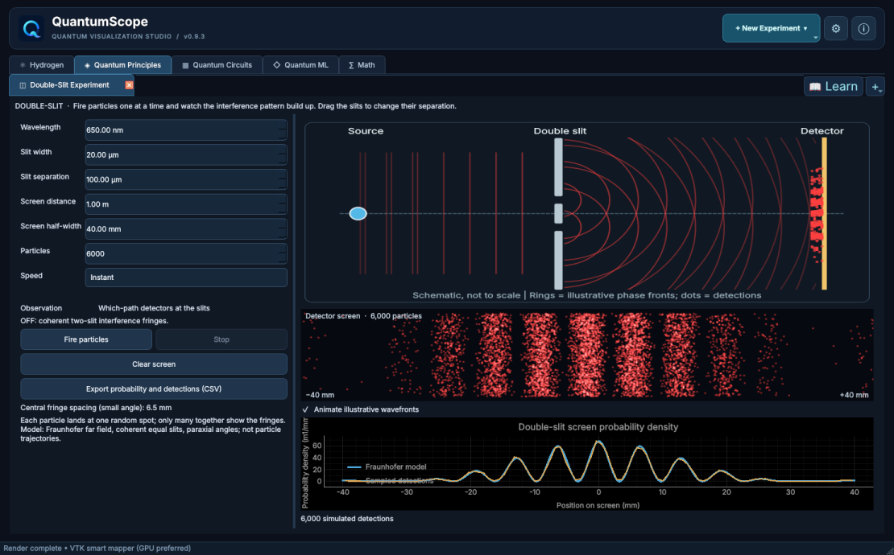

- **Areas:** the five tabs under the title, **Hydrogen**, **Quantum Principles**, **Quantum Circuits**, **Quantum ML** and **Math**, are the five areas of the app.
- **Experiment tabs:** each area holds experiment tabs. Open more with **+** on the right of the tab bar, or with **+ New Experiment** at the top. Every tab can be closed with its **×**. A closed tab is only hidden, so opening it again brings it back exactly as you left it. An area with no open tabs shows a **Start** page with its experiments as buttons.
- **Tabs in their own windows:** **⧉** next to **Learn** (or right-click a tab → **Open in its own window**) moves the tab into a window of its own, which can be any size and shape, on any screen. **Dock back**, or closing that window, puts it back as a tab.
- **Side panels:** the **«** button at the edge of a side panel (the controls, the gate palette, the lesson list) folds it to a narrow strip with its name; **»**, or a click on the name, opens it again. QuantumScope remembers which panels are folded. The groups inside a panel (**Data**, **Preprocessing**, …) fold too: click a group's title, by its **▾**, to fold it to that title, and again to open it; these are remembered as well.
- **Small screens:** when the window is shorter or narrower than an experiment needs, the area scrolls (scrollbar on the right) instead of the window growing past the edge of the screen. QuantumScope also opens no larger than the screen.
- **A graph in its own window:** the **⧉** in the corner of a graph (and beside **Save image…** in a 3-D view) opens it in a window of its own, for a second screen, a projector or two graphs side by side. It keeps updating as you work. **Bring it back here**, where it was, or closing its window puts it back.
- **Search:** the **Search…** box at the top finds an experiment, a Learn area or Settings by name or topic: type *SVM*, *Bell*, *QUBO* or *Grover*, then pick one or press Enter.
- **Dots on tabs:** an orange dot on a tab (and on its area's tab) means something there is new while you were elsewhere: a long run has finished, or the classifiers' data changed in the Datasets tab (train again to use it). Hover over the dot to see what; it goes when you open the tab.
- **📖 Learn** opens the study guide for the current area (chapter 8).
- **⚑** opens **Report a problem** (chapter 10). **⚙** opens **Settings** (chapter 9). **ⓘ** shows **About QuantumScope**, including **Check for updates…** and **User guide**, which opens this document.
- **Charts:** right-click any chart for **View All**, the axis options, **Save image…** (PNG or JPEG at twice the screen resolution), **Copy image** and **Save data (CSV)…**.
- **Long computations** (training, **Optimize**, **Best of N**, the landscape) run in the background with their progress shown, so the window never freezes; **Stop** or **Cancel** ends them early. When one that took more than a few seconds ends (training, cross-validation, a grid search, an anneal, an optimization), the status bar at the bottom says so, with how long it took; if you were in another program meanwhile, QuantumScope's taskbar button (Windows, Linux) or Dock icon (macOS) asks for your attention.

When QuantumScope starts, its logo appears for a moment while the 3-D libraries load.

## 3. Hydrogen

The **Hydrogen Explorer** draws the hydrogen atom's orbitals in 3-D, exactly solved for the Schrödinger equation (with the proton's finite mass).

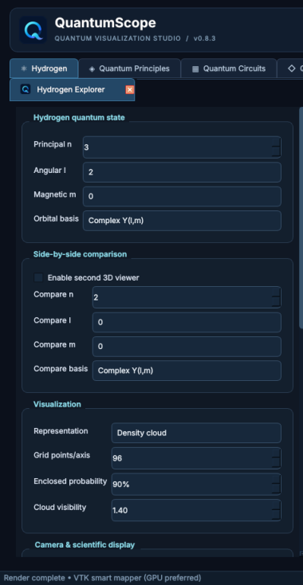

**Choosing a state.** Under **Hydrogen quantum state**, set **Principal n**, **Angular l** and **Magnetic m**. **Orbital basis** chooses between the complex orbitals **Y(l,m)** and the **Real cosine** or **Real sine** combinations (the familiar px, dxy shapes). Press **Render state** to draw it; with **Update when changing state/mode** ticked, it redraws by itself.

**How it is drawn.** Under **Visualization**:

- **Representation:** **Density cloud** (a glowing cloud), **Probability enclosure** (a surface containing a chosen share of the probability), **Real(psi)** or **Imag(psi)** (red where that part of ψ is positive, blue where it is negative).
- **Enclosed probability** sets that share for the enclosure, for example 90%.
- **Grid points/axis** trades detail for speed, and **Cloud visibility** adjusts the cloud's brightness.
- **Color enclosure by wavefunction phase** colours the surface by the phase of ψ.

**The view.** Drag in the 3-D view to turn it, scroll to zoom, and Ctrl-drag (or middle-drag) to move it. Under **Camera & scientific display**, **View** jumps to **Perspective**, **+X**, **+Y** or **+Z**, and **Magnification** zooms. **Show axes and coordinates (a_mu)** adds axes in units of the (reduced-mass) Bohr radius. **Reset camera** returns to the start.

**Comparing two orbitals.** Tick **Enable second 3D viewer** under **Side-by-side comparison** and choose **Compare n**, **l**, **m** and **basis**. **Synchronize comparison cameras** keeps both views turned together.

**The radial chart** below the view shows P(r) = r²|Rnl(r)|², the probability of finding the electron at distance r.

**Exporting.** **Export PNG** saves the view (at the **PNG export scale**, 1–4×), and **Export grid (.npz)** saves the computed values for your own analysis.

### Hydrogen Dynamics 2D and 3D

Open these with **+** in the Hydrogen area. They show a superposition of two states, **State A** and **State B**, evolving in time: the cloud moves because the two energies differ (a **quantum beat**).

- **State A probability** and **Initial phase** set the mixture.
- **Time / beat period** moves through one beat; **Play** animates it.
- The 2-D version shows a **Cross-section plane**; the 3-D version shows the full cloud.
- **Exports:** a frame as PNG, a full period as an animated GIF (with **GIF frames / period** and **GIF frames per second**), and, in 2-D, the slice as NPZ data.

## 4. Quantum Principles

Four hands-on experiments on the ideas behind quantum mechanics. They share some controls:

- **Bloch spheres:** **left-drag** sets a state (or, in Entanglement, aims a detector). **Right-drag**, or **Shift + left-drag** on a trackpad, turns the sphere to look from any side, and **double-click** resets the view.
- **Speed:** experiments that repeat measurements offer **Slow**, **Fast** and **Instant**, with **Stop**.

### Double-Slit

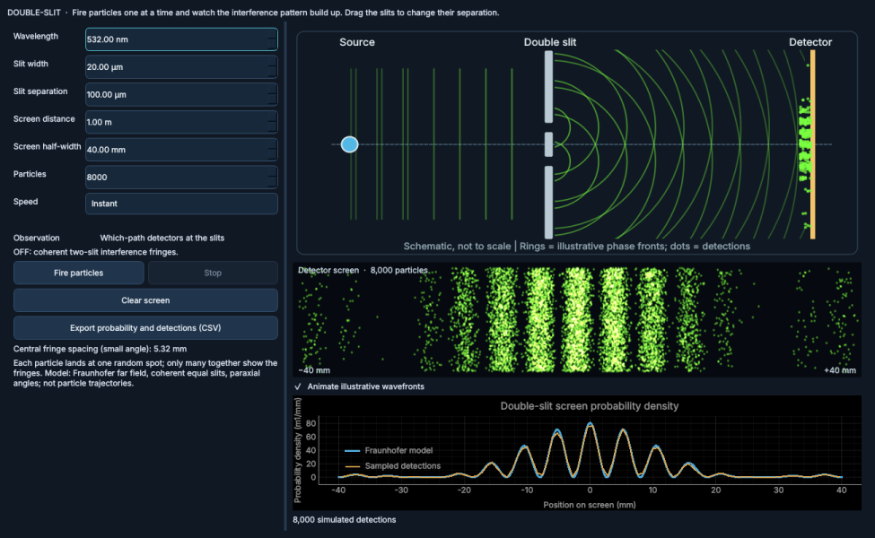

Particles pass through two slits and land on a screen. **Fire particles** sends them one after another: each lands as a single dot, and the interference fringes appear only as the dots pile up. The chart compares the detections with the exact pattern.

- **Wavelength** sets the light's colour; ultraviolet and infrared are shown in a labelled false colour.
- **Slit width**, **Slit separation**, **Screen distance** and **Screen half-width** set the geometry. You can also **drag the slits** in the drawing up or down to change their separation.
- **Which-path detectors at the slits** destroy the interference: the fringes give way to a single broad band.
- **Clear screen** starts again; **Export probability and detections (CSV)** saves the data.

### Superposition

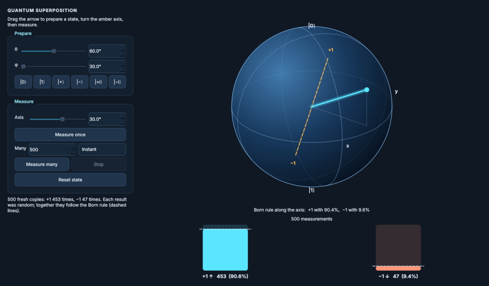

- **Prepare** a spin-½ state by **dragging the arrow**, with the **θ** and **φ** sliders, or with a preset: |0⟩, |1⟩, |+⟩, |−⟩, |+i⟩ or |−i⟩.
- **Measure:** **Axis** turns the amber measurement axis, whose ends are the results +1 and −1.
  - **Measure once:** the arrow jumps to +1 or −1 with a flash (the collapse). **Reset state** returns to the prepared state.
  - **Measure many:** fresh copies are measured one after another, and the bars grow toward the dashed **Born-rule** predictions.

### Entanglement

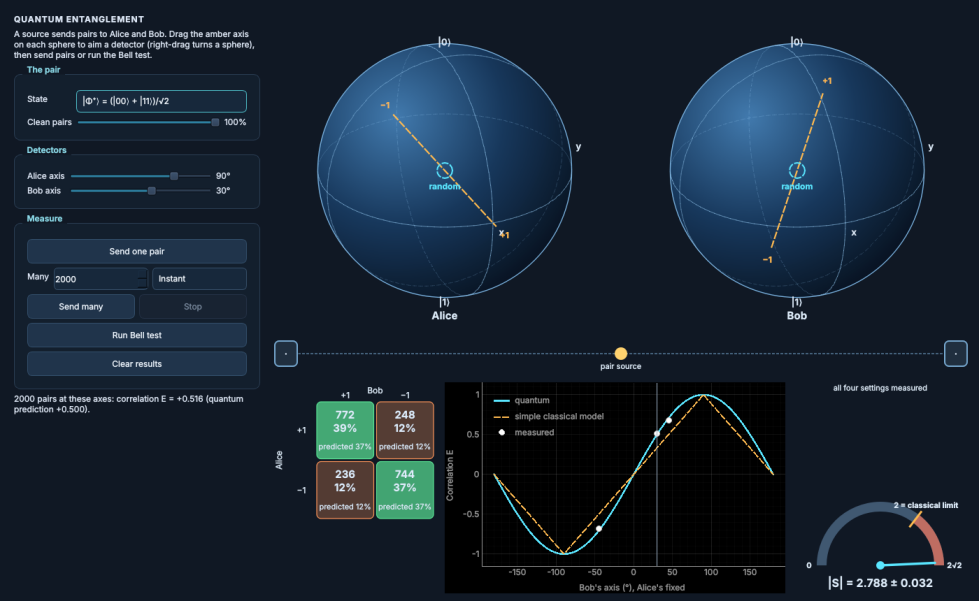

A source sends pairs of qubits to Alice and Bob.

- **The pair:** choose a Bell state, or a **classically correlated** pair for comparison. **Clean pairs** adds noise.
- **Each sphere shows that qubit's own state:** for an entangled pair, **random**, since neither qubit has a state of its own.
- **Aim the detectors** by dragging the amber axis on each sphere, or with the **Alice axis** and **Bob axis** sliders.
- **Send one pair** follows a single pair: Alice measures, both qubits become definite, then Bob measures. No signal travels: on his own, Bob's results stay random.
- **Send many** fills the **grid** of joint results and the **correlation curve**, which compares the measurements with the quantum prediction and a simple classical model.
- **Run Bell test** measures the four standard detector settings and shows **|S|** with its uncertainty on the meter. Entangled pairs beat the classical limit of 2, up to 2√2 ≈ 2.83; noisy or classical pairs do not.

### Teleportation

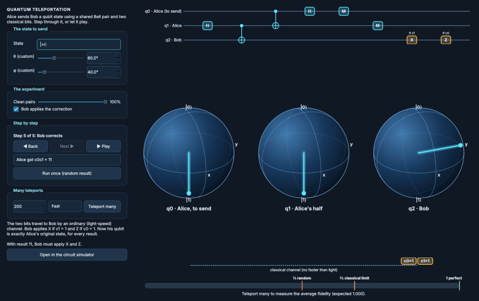

Alice sends Bob a qubit's state using a shared Bell pair and two classical bits.

- **The state to send:** a preset, or **Custom** with θ and φ; at step 1 you can also drag the arrow on q0.
- **Step by step:** **◀ Back**, **Next ▶**, or **▶ Play**. The circuit at the top highlights each step. When Alice measures, her two bits travel to Bob along the classical channel before he applies his correction.
- **The measurement result:** choose one of the four, keep "unknown to Bob" for the average, or **Run once (random result)**.
- **Experiments:**
  - **Clean pairs** adds noise to the shared pair, lowering the fidelity.
  - **Bob applies the correction** can be unticked, to see why the classical bits are needed.
- **Teleport many** measures the average fidelity over many runs, against ½ (random), ⅔ (the best possible without entanglement) and 1.
- **Open in the circuit simulator** loads the same protocol as a circuit.

## 5. Quantum Circuits

The **Gate Circuit Simulator** builds and simulates circuits of up to 10 qubits, exactly.

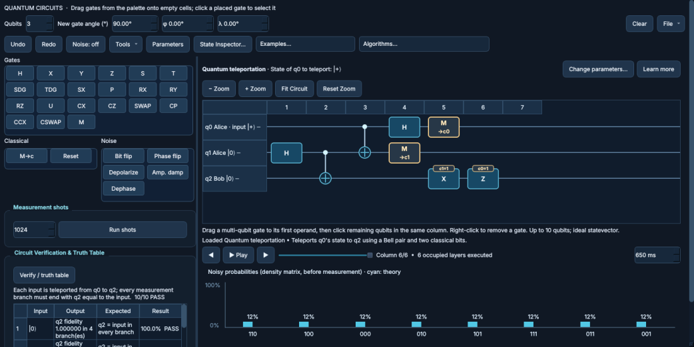

### Building a circuit

- **Qubits** sets the number of qubits. **New gate angle** sets the angle given to new rotation gates (with **φ** and **λ** for the U gate).
- **Placing gates:** drag a gate from the palette on the left onto an empty cell. For a gate on several qubits (**CX**, **CZ**, **SWAP**, **CP**, **CCX**, **CSWAP**), drop it on its first qubit, then click the other qubits in the same column.
- **Editing:** click a placed gate to select it. **Double-click** it to edit its angles (or a noise box's strength); double-clicking a grouped **block** expands it. **Right-click** removes a gate.
- **Qubit labels:** right-click a qubit's name on the left to give it a label, such as *data* or *Alice*.
- **Undo** and **Redo** step through changes. **Clear** empties the circuit.
- **Zooming:** **− Zoom** and **+ Zoom**, **Fit Circuit** and **Reset Zoom**.
- **The palette:**
  - **Gates:** H, X, Y, Z, S, T, SDG, TDG, SX, P, RX, RY, RZ, U, CX, CZ, SWAP, CP, CCX, CSWAP and M (a final measurement).
  - **Classical:** **M→c**, a measurement in the middle of the circuit into a classical bit, and **Reset**.
  - **Noise:** **Bit flip**, **Phase flip**, **Depolarize**, **Amp. damp** and **Dephase**, which can be placed like gates.
  - **Double-click** any gate or noise item in the palette for an explanation of what it does.

### Running and reading results

- **Playback:** **◀**, **▶ Play** and **▶** step through the circuit column by column; the probabilities and Bloch spheres show the state at that point.
- **Probabilities:** the chart shows each basis state's probability, with the theory in cyan. The line underneath lists them.
- **Measurement shots:** set the number of shots and press **Run shots** to sample results as an experiment would.
- **State Inspector…** opens a window with the **Amplitudes**, **Statevector**, **Reduced state** (each qubit's own state), **Circuit** statistics and, for circuits with mid-circuit measurements, **Branches**.

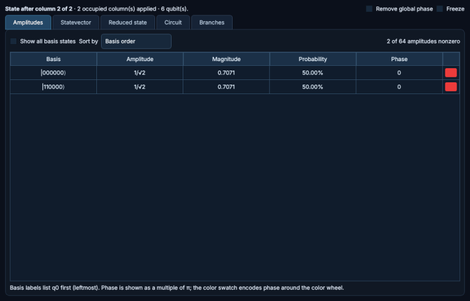

### Examples, algorithms and checking

- **Examples…** loads ready-made circuits: the Bell pair, GHZ, adders and comparators, teleportation, superdense coding, and the bit-flip, phase-flip and Shor codes.
- **Algorithms…** loads Deutsch, Deutsch–Jozsa, Bernstein–Vazirani, Grover search, the quantum Fourier transform, phase estimation, VQE, VQLS and QAOA. A bar above the circuit names the example; **Change parameters…** adjusts it, and **Learn more** opens its lesson.
- **Verify / truth table** checks the circuit against its specification: for an example, every required input; for your own circuit, a truth table of basis-state inputs.
- **Plot logical error rate** appears for error-correction examples, **Show the graph** for QAOA, and **Show the solution** for VQLS.
- **Noise: off** opens the noise settings: presets, error rates, idle noise and readout errors. With noise on, the simulation uses density matrices.

### Parameters and optimization

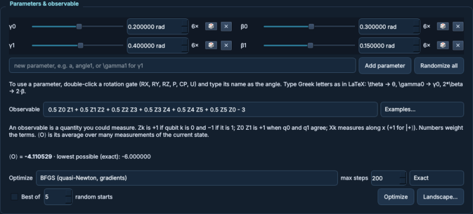

Press **Parameters** to show the panel.

- **Parameters:** add a name with **Add parameter** (type \theta for θ, \gamma0 for γ0). Then double-click a rotation gate and type the name, or a multiple like 2*\beta, as its angle.
  - **Sliders** change parameters live. On wide windows they show in two columns.
  - **🎲** randomizes one parameter, and **Randomize all** randomizes every one.
- **Observable:** type a weighted sum of Pauli terms, such as Z0 Z1 + 0.5 X0, or pick one from **Examples…**. The panel shows its expectation value ⟨O⟩ and the lowest possible value.
- **Optimize** lowers ⟨O⟩ with the chosen method: **BFGS**, **Gradient descent**, **Adam**, **SPSA** (two circuit runs per step), **Rotosolve** (each parameter set to its exact minimum in turn), the **Quantum natural gradient**, **Simulated annealing**, **COBYLA** or **Nelder–Mead**; hover over a method for a short description. **Best of N random starts** also tries random starting values and keeps the best.
- **Shots:** **Exact**, or 100, 1,000 or 10,000 measurements of each term of the observable, as on real hardware. With shots the optimizer only sees noisy energies, gradients come from the parameter-shift rule, and the Optimize chart draws the measured ⟨O⟩ (thin) beside the true ⟨O⟩ (bold), with the number of measurements used. Lecture "Optimizing with shots" compares the methods.
- **Landscape…** draws ⟨O⟩ over two parameters, with the optimizer's path.

### Solving linear systems (VQLS)

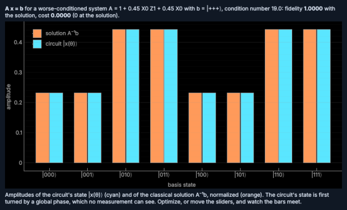

**Algorithms… → Variational quantum linear solver** prepares a state proportional to the solution of A x = b. Choose the standard 3-qubit system, a worse-conditioned one, a 1-qubit one, or **Your own system**: A as a sum of Pauli terms on 1 to 3 qubits (it must be invertible) and b as |0…0⟩, |+…+⟩ or |1…1⟩. The observable is the VQLS cost, which is 0 exactly at the solution. Press **Optimize**, then **Verify / truth table**: the check passes at a fidelity of at least 0.99 with the classical solution. **Show the solution** compares the amplitudes as you go.

### Quantum annealing

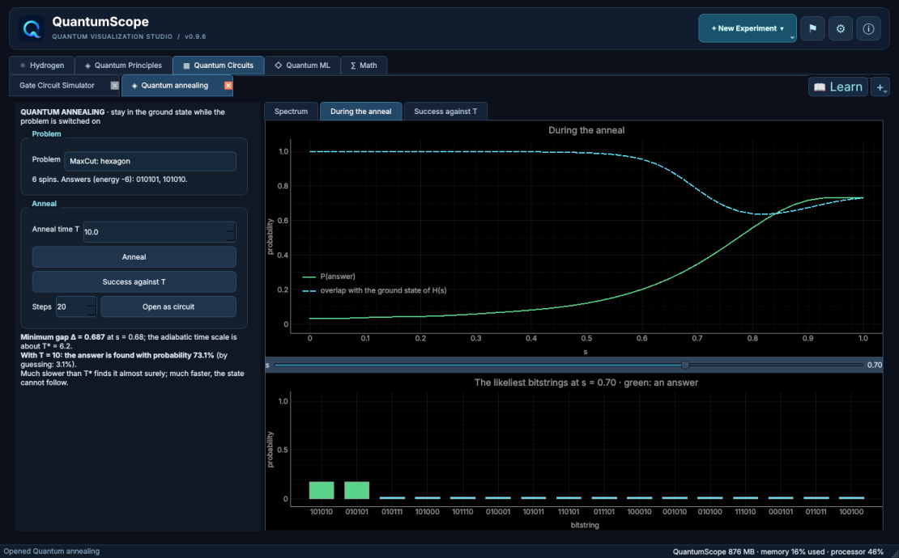

Open **+ → Quantum annealing**. It anneals from the easy ground state of −ΣX to the ground state of a problem, the answer, and shows why the anneal time matters.

- **Problem:** MaxCut on five small graphs, a **Spin glass** (choose the spins and an instance), **Number partitioning** (type the numbers) or **Your Ising problem** (Z terms, such as Z0 Z1 − 0.5 Z2). The answers and their energy are listed.
- **Anneal** runs an anneal of time **T** and shows:
  - **Spectrum:** the lowest levels of H(s), with the minimum gap circled. The panel reports the gap and the adiabatic time scale T*.
  - **During the anneal:** the probability of the answer, and the overlap with the instantaneous ground state, as s goes from 0 to 1. The slider shows the likeliest bitstrings at any s (answers in green).
- **Success against T** anneals for T from 0.5 to 80 and plots how often the answer is found, with the chance of guessing and T*.
- **Open as circuit** turns the anneal into gates (digitized annealing) with the chosen number of **Steps**, and opens it in the simulator with the problem as the observable. One **Undo** brings back your previous circuit.

For MaxCut and number partitioning, flipping every spin gives the same answer, so the spectrum shows only the levels the anneal can reach. Lecture "Quantum annealing" and its lab explain the physics.

**Feature selection (from data)** puts annealing to a real use: choosing which features of a dataset a classifier keeps, one per qubit.

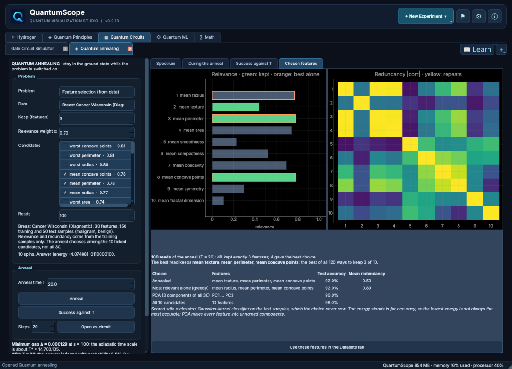

- **Data:** a built-in dataset, or **From the Datasets tab** (your own CSV too), cleaned and split as the Datasets tab does. Only the training samples are used to choose.
- **Keep (features)** and **Relevance weight α**: each candidate is a spin; the energy rewards features that separate the classes on their own (relevance) and charges for pairs that repeat each other (redundancy), with a penalty unless exactly that many are kept. α = 1 ignores redundancy.
- **Candidates:** every feature, ranked by relevance; at most 10 can be ticked (one spin each). The 10 most relevant are ticked to begin with.
- **Reads:** how many times the anneal is run and measured, keeping the best choice seen, as real annealers are used.
- **Chosen features** shows the relevance of each candidate (green: kept), the redundancy between them, and a table of test accuracies for the annealed choice, the most relevant features alone (greedy), PCA and all candidates, scored with a classical classifier on test samples the choice never saw. **Use these features in the Datasets tab** prepares the data with them, for both classifiers.

With at most 10 candidates, every choice could also be checked directly by a classical computer: the experiment shows how the problem is formulated and solved, not a speed-up. Lecture "Choosing features by annealing" and its lab explain it.

### Files and tools

- **File:** **Open .qscope…**, **Open recent**, **Save .qscope…**, **Import OpenQASM 2…**, **Export OpenQASM 2…** and **Export PDF…** (the circuit diagram, optionally with a probability report). A circuit too long for one line at a readable size is drawn in parts, one under another and over as many A3 pages as it needs; above 10 pages, QuantumScope asks first.
- **Tools:** **Simplify circuit…** and **Check equivalence with a saved circuit…**.
- **File → Run on IBM Quantum hardware…** writes ready-to-paste Python that runs the circuit on a real IBM quantum computer with your own IBM Quantum account (the free Open Plan includes a few minutes of quantum time per 28 days). QuantumScope never contacts IBM, and the API key and instance CRN you type only fill in the code: they are not saved. Four steps, each with **Copy**:
  1. install Qiskit;
  2. save your account once (or use environment variables, or, not recommended, write the key into the script);
  3. run the circuit on your computer first, ideally and with the simulated noise of a real IBM device, with no account;
  4. run it on the least busy device with enough qubits (or one you name), and print the counts with q0 first, as QuantumScope shows them.

  **Save the hardware script…** saves step 4 as a .py file. Mid-circuit measurements, resets and conditions run as dynamic circuits; QuantumScope's noise settings are left out, since the hardware has its own noise.
- **The QASM Converter** (open it with **+**) converts between OpenQASM 2 and QuantumScope's .qscope format.
- **The Error-correction explorer** (open it with **+**) compares how the error-correcting codes perform as noise grows.
- **Autosave:** QuantumScope saves your circuit as you work and offers to recover it after a crash (see **⚙ → Files**).

## 6. Quantum ML

The **Quantum ML** area turns data into quantum states and learns from them. Its four experiments open from **+**: **Datasets**, **Quantum Kernel Classifier**, **Variational Classifier** and **Hybrid QNN**. Everything runs offline; the nine built-in datasets are part of the app.

### Datasets

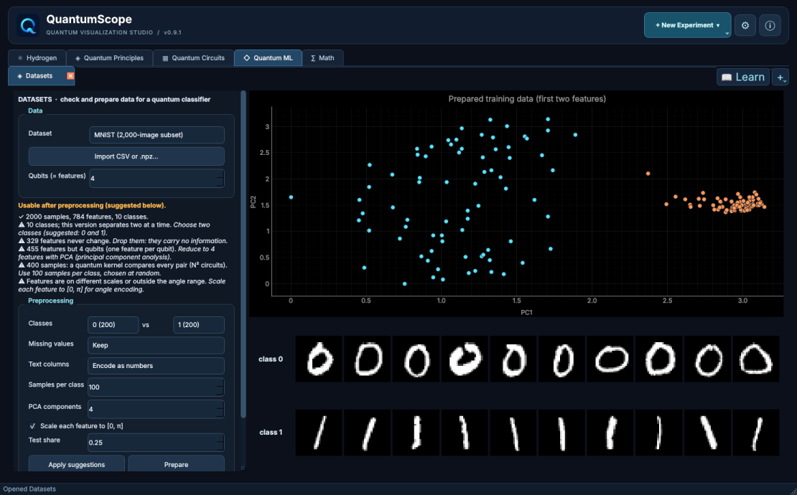

- **Dataset** picks a built-in dataset (Iris, Wine, Breast Cancer Wisconsin, Digits 8×8, a 2,000-image MNIST subset, a 2,000-image Fashion-MNIST subset, Palmer Penguins, Seeds and Glass Identification) or a synthetic one (moons, circles, XOR, blobs). To use your own data, choose **Your own file (CSV or .npz)…** at the top of the **Dataset** list (or **Choose the file…** for another file); the list then shows the file's name. A CSV opens in a preview first: scroll through its rows and columns, choose the **Label column** (from the list, or by clicking a column's name; QuantumScope suggests one named label, target, class … or the last), and untick the columns not to learn from (row numbers and IDs are left out already). It warns when the chosen label looks like a measurement rather than a class, and **The first row names the columns** fixes a header that was taken for data, or the reverse. A NumPy file needs arrays named X and y.
- **Qubits (= features)** is how many features the prepared data will have: each classifier encodes one feature per qubit.
- **The checker** gives a verdict (ready, usable after preprocessing, or cannot be used) and lists what stands in the way, each with a suggested fix: too many features, too many samples, more than two classes, classes too small to learn from, text columns, missing values, or features on different scales.
- **Preprocessing** shows every step and lets you change it: **Classes** (two to separate, or **All classes**), **Missing values**, **Text columns**, **Samples per class**, **PCA components**, scaling to [0, π] and the **Test share**. **Apply suggestions** restores the checker's recipe, and **Prepare** prepares the data and shares it with both classifiers.
- **Or keep features → Choose by annealing…** keeps named features instead of PCA components: it opens this data in **Quantum annealing** as a feature-selection problem, and **Use these features in the Datasets tab** brings the choice back. **Clear** returns to PCA. If the classes, samples or test share change afterwards, the chosen features are set aside, since they were chosen for a different split.
- The data is split into training and test sets first, and every learned step (means, PCA, scaling) is fitted on the training part only, so the test accuracy is honest.
- The plot shows the prepared training data, with a legend when there are more than two classes; for Digits, MNIST and Fashion-MNIST, example images of the chosen classes appear below it.
- **Licences:** every built-in dataset is public and redistributed under its own licence (CC BY 4.0, CC BY-SA 3.0, CC0 or MIT), listed with its citation in the app's `ml/data/DATASETS.md`.

### Quantum Kernel Classifier

- **Data:** choose **From the Datasets tab**, or any dataset directly; it is then prepared with the checker's suggested recipe. For a dataset with more than two classes, **Classes** chooses the pair to separate, or **All classes**: one classifier per class, each telling its class from all the others (one-vs-rest), all sharing one kernel matrix. The prediction is the most confident class.
- **Feature map:** **Angle encoding** (RY on each qubit) or the entangling **ZZ feature map**, with its **Repetitions**. **Bandwidth** scales the data before encoding: smaller values make the kernel smoother.

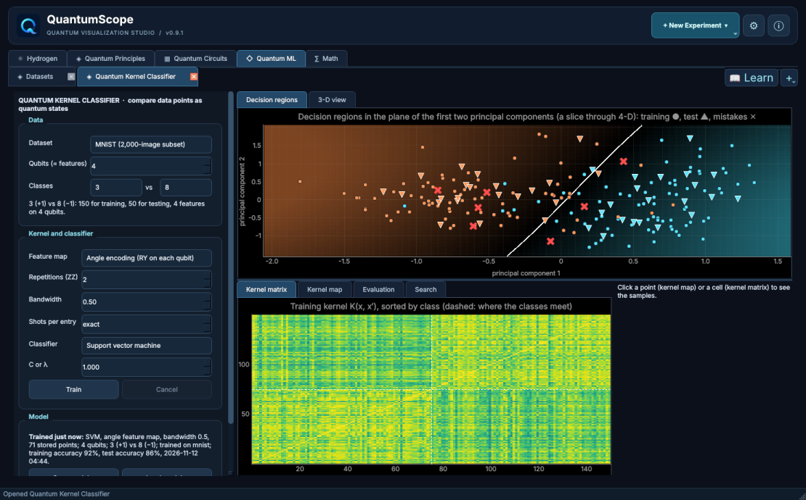

- **Shots per entry** estimates each kernel value from that many shots, as a quantum computer would; **exact** computes it exactly.
- **Classifier:** a **Support vector machine** or **Kernel ridge**, with its strength **C or λ**. **Train** builds the kernel and the classifier in the background, so the window stays responsive; **Cancel** stops it.

- **The decision regions** show the predicted class behind the points, deeper where the classifier is more confident, with the boundary as a white line. With more classes, each region has its class's colour and a legend names them. Training points are dots, test points triangles, and mistakes are marked ✕. With more than two features, the regions are drawn in the plane of the two leading principal components, a slice through the data.
- **3-D view** (the tab beside **Decision regions**): the points along three axes, **Principal components** or **Separating axes** (the first runs from one class's centre to the other's), with the decision boundary as a surface and, for a support vector machine, the **Margins**. With more than two classes, each class's region has its own coloured surface, and **Separating axes** follow the spread of the class centres. Support vectors have a soft halo; test points are cubes and mistakes are red. Drag to rotate, scroll to zoom, Ctrl-drag (or middle-drag) to pan, or use **Front**, **Top**, **Side**, **Isometric** and **Reset**; click a point to see its sample. With more than three features the view is a slice, and the caption says how often the slice agrees with the classifier. **Save image…** and **Save rotating GIF…** (a full turn, for slides) keep the view.
- **Below the decision regions,** two tabs show the kernel itself (drag the divider to give either part more room):
  - **Kernel matrix:** the training kernel sorted by class. Hover over a cell to see its value and the two samples' classes; click it to see both samples beside the tabs (for Digits and MNIST, the images).
  - **Kernel map:** the data as the kernel sees it (kernel PCA): points the kernel finds similar lie close together. Click a point to see that sample, its prediction and its decision value. If the points scatter apart with no structure, the kernel has concentrated.
- If the kernel is close to 0 for different points (kernel concentration), the result says so and suggests a smaller bandwidth.
- **Evaluation** (a tab beside the kernel views): the test set's accuracy, balanced accuracy, precision, recall, specificity, F1 and AUC, the confusion matrix and the ROC curve. With more than two classes: accuracy, balanced accuracy, macro-averaged precision, recall and F1, the hardest class, a k × k confusion matrix (green where a class was recognized, red where it was taken for another) and a one-vs-rest ROC curve per class with their mean AUC. **Cross-validate** trains on k − 1 parts of the training data and checks the remaining part, k times, for a steadier estimate than a single test score.
- **Search:** choose the feature maps, classifiers, bandwidths, repetitions and C or λ values to try, and the number of folds. **Search** cross-validates every combination on the training data (the test set stays untouched), lists them best first, and **Use best** applies the winner and trains it.

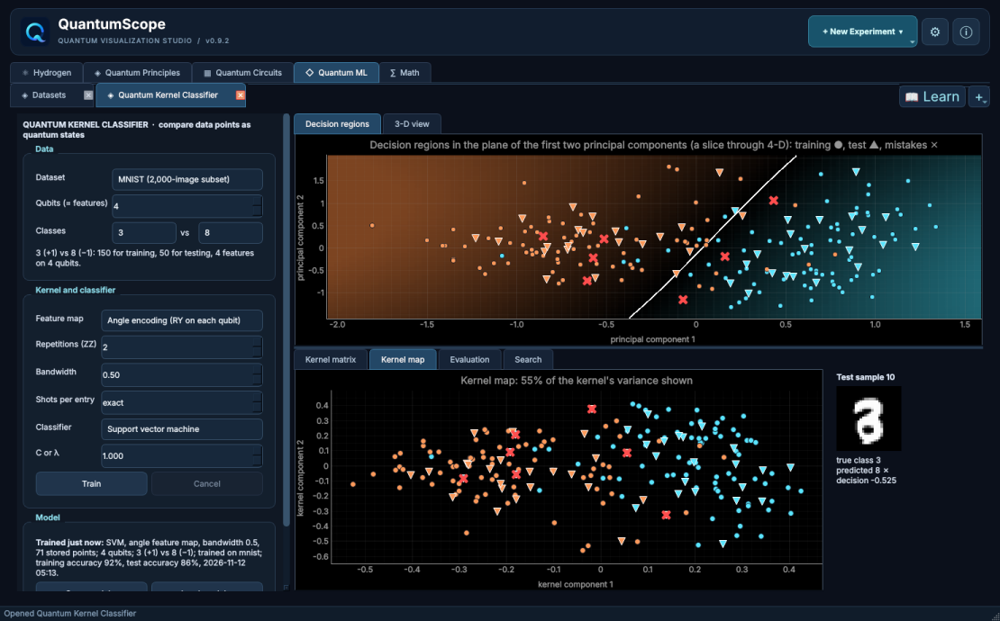

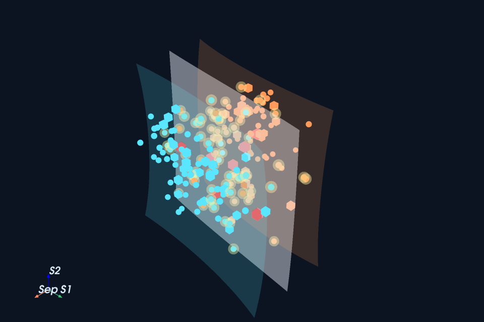

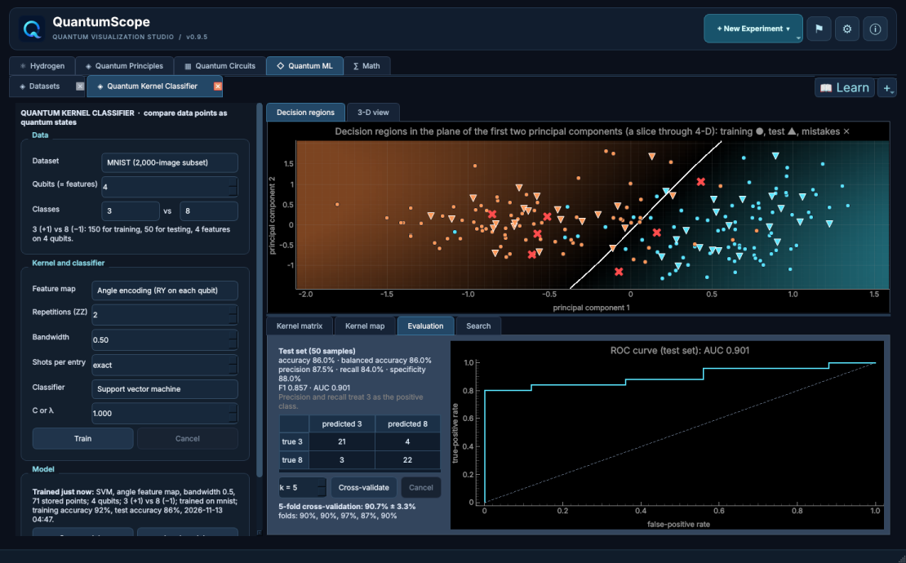

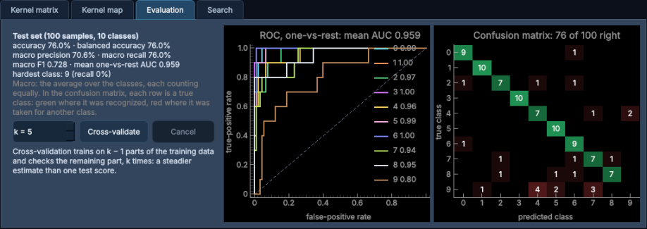

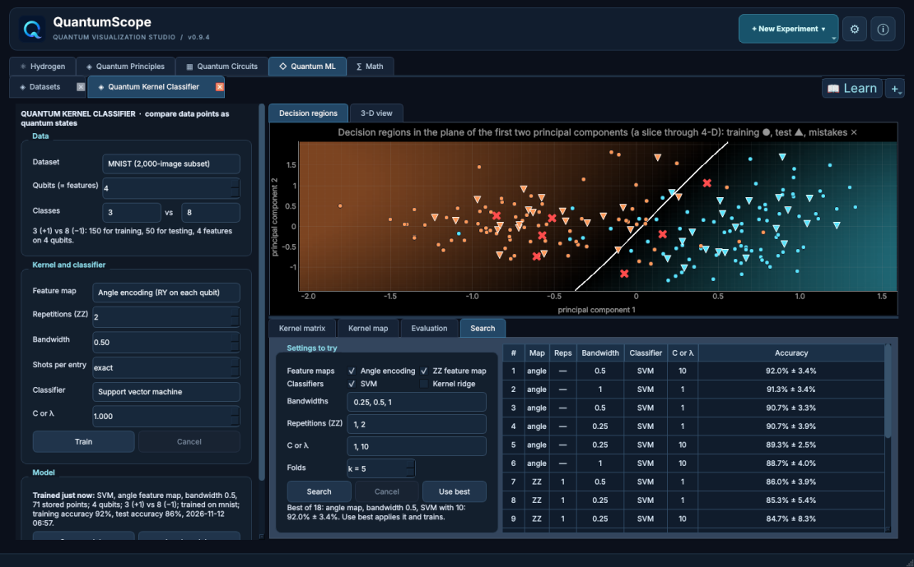

### Saving and using a model

Both classifiers have a **Model** panel. After training, **Save model…** stores the model as a small `.npz` file: the classifier, its settings, and the preprocessing it was trained with (the classes, PCA, scaling and so on), so new data is prepared exactly like the training data. **Load model…** opens a saved model and sets the controls to match it. **Predict on a file…** predicts every sample in a `.csv` or `.npz` file with the same raw features as the training data: CSV columns are matched by name, and a label column is optional. The results show each sample's prediction and decision value, and, when the file has labels, the true class, whether the prediction was correct, and the accuracy. **Export CSV…** saves them. A model of more than two classes shows each sample's predicted class and its confidence (the winning classifier's decision value). Model files are never run as code, so they are safe to share; a two-class model saved by this version still opens in older versions.

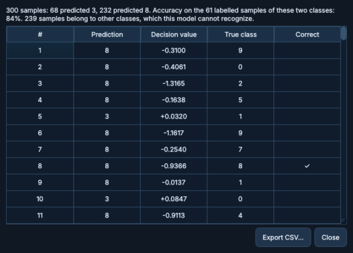

### Variational Classifier

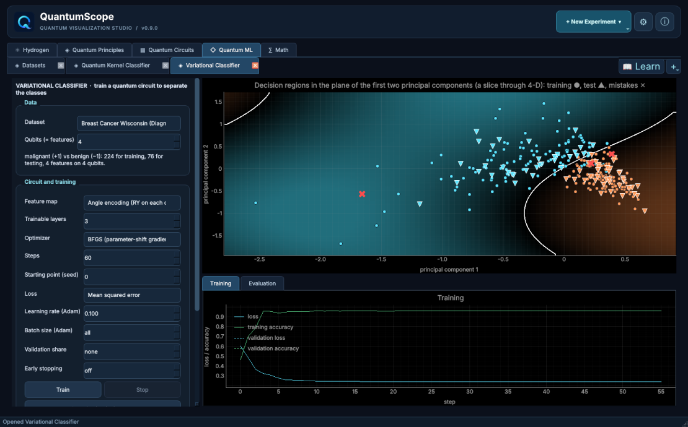

- The circuit is the feature map followed by **Trainable layers** of RY gates and CNOTs; its output is ⟨Z₀⟩ plus a bias.
- **More than two classes:** choose **All classes**. The first ⌈log₂ k⌉ qubits are measured and each outcome names a class (2 qubits for three species, 4 for ten digits); the loss is then cross-entropy. You need at least that many qubits.
- **Optimizer:** **BFGS**, with exact gradients, **Adam**, or **Gradient descent**, the textbook method: each step moves the learning rate times the gradient downhill. Set the **Steps** and the **Starting point (seed)**.
- **Loss:** mean squared error, hinge (as an SVM) or cross-entropy. With Adam or gradient descent, set the **Learning rate** (too large and the loss jumps around or blows up, too small and it crawls) and a **Batch size** (each step on a random batch). BFGS chooses its own step size, so it has no learning rate.
- **Validation share** holds out part of the training data; its loss and accuracy appear as dashed curves. **Early stopping** then ends training when the validation loss stops improving, and keeps the best step.
- **Evaluation** (a tab beside **Training**) shows the same metrics, confusion matrix and ROC curve as the kernel classifier, and can cross-validate the current settings.
- **Train** shows the loss and the training accuracy step by step, and the decision regions as they change; **Stop** ends training early.
- **Open in circuit simulator** loads the trained circuit for one test point into Quantum Circuits, with the observable Z0, or, for more classes, with the readout qubits measured: run shots and read the class from the outcome.

### Hybrid QNN

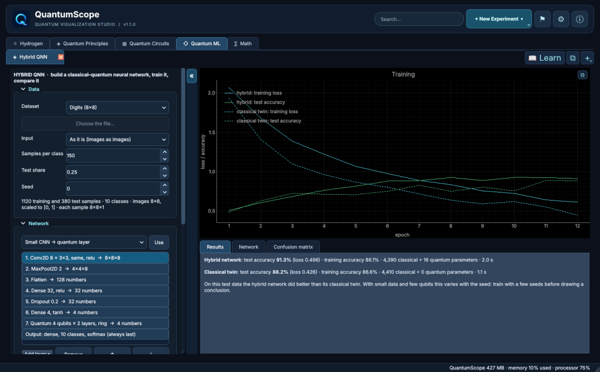

A hybrid quantum neural network: classical layers, a quantum layer, and an output layer, built here layer by layer and trained together.

- **Data:** any built-in dataset, or **Your own file (CSV or .npz)…**. **Input** decides how a sample enters the network: *as it is* (images keep their height × width), *features* (a vector) or *a sequence* (the features in order, for 1-D convolutions). Images are scaled to [0, 1]; other data are standardised with the training data's mean and spread. Set the **Samples per class** (fewer train faster), the **Test share** and the **Seed**.
- **Network:** start from a ready-made network (**Use**), then **Add layer ▾**, **Remove**, or move a layer with **↑** and **↓**; choose a layer in the list to change its settings. The layers are **Dense**, **Conv1D**, **Conv2D**, **MaxPool** and **AvgPool** (1-D and 2-D), **Global average pooling**, **Dropout**, **BatchNorm**, **Flatten**, **Activation** (ReLU, leaky ReLU, tanh, sigmoid, GELU) and the **Quantum layer**. The list shows each layer's output shape, and the line under it the classical and quantum parameters. A layer that does not fit says what to change, and **Train** waits until it does. The output layer, one unit per class with softmax, is always last.
- **The quantum layer** takes one number per qubit (so the layer before must give exactly that many: a **Dense** layer with that many units and tanh is usual), turns each into the angle of an RY rotation (**Angle scale** × the number), then applies **Quantum layers** of trainable RY and RZ rotations on every qubit followed by CNOTs (**Entanglement**: ring, line or none), and passes on ⟨Z⟩ of each qubit. Its gradients, also those passed back to the classical layers before it, are exact (the adjoint method). Up to 8 qubits.
- **Training:** **Epochs**, **Batch size** and **Learning rate** (Adam), with cross-entropy loss. **Train** shows the training loss and the test accuracy epoch by epoch; **Stop** ends it.
- **Also train the classical twin** trains the same network with each quantum layer replaced by a dense layer of the same width (tanh), on the same data. **Results** compares the two; with small data and few qubits the difference changes with the seed, so train with a few seeds before drawing a conclusion. **Network** lists every layer with its output shape and parameters, and **Confusion matrix** shows the hybrid network's errors on the test data.
- Everything runs on your computer's processor, in NumPy: networks of a few thousand parameters on a few thousand small samples train in seconds to minutes.

## 7. Math

The **Math** area holds the **Quantum Calculator**: the mathematics behind every other part of the app, in Dirac notation, worked out exactly or in digits. Open it with **+** → **Quantum Calculator**, or from a Mathematics lesson's **Try it in the calculator** link, which opens it with the lesson's example already worked out.

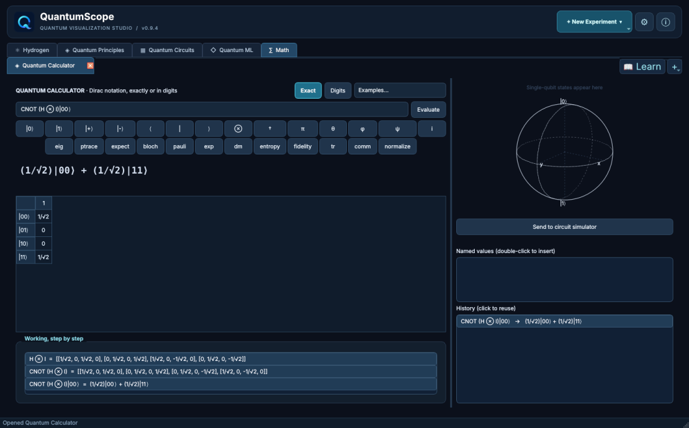

### Typing expressions

Type an expression and press **Enter**; **↑** and **↓** recall earlier ones. The buttons under the input insert symbols and functions at the cursor, and **Examples…** lists ten to start from. Every symbol also has a keyboard form:

| Write | As | Keyboard |
|---|---|---|
| A ket, a bra | \|0⟩, \|+⟩, \|01⟩; ⟨0\| | \|0>, <0\| |
| An inner product, a matrix element | ⟨0\|1⟩, ⟨0\|X\|1⟩ | <0\|1>, <0\|X\|1> |
| A product | H\|0⟩ or H * \|0⟩ | |
| A tensor product | X ⊗ Y | X (x) Y |
| The adjoint | H† | H' |
| A power, a matrix | X^2; [1, 0; 0, -1] or [[1, 0], [0, -1]] | |
| A name | ψ = H\|0⟩, then ⟨ψ\|Z\|ψ⟩ | |

The states |0⟩, |1⟩, |+⟩, |−⟩, |i⟩ and |−i⟩ are built in, as are the gates I, X, Y, Z, H, S, T, CNOT, CZ and SWAP and the rotations RX, RY, RZ, P and U. **⊗ binds more tightly than products written side by side:** H ⊗ I |00⟩ is (H ⊗ I)|00⟩. To combine two prepared states, use brackets: (RY(θ)\|0⟩) ⊗ \|1⟩. If a product does not fit, the message says so and suggests the brackets.

### Exact and Digits

- **Exact** keeps √2, i and π, and leaves names without values, such as θ, as symbols: exp(−i θ X / 2) gives the rotation matrix in terms of θ.
- **Digits** computes numbers, and still shows familiar values exactly (1/√2, √3/2, i/√2).

The same expression means the same in both modes; switching recalculates the current one.

### Functions

**exp** (of a matrix: the matrix exponential), **sqrt**, **sin**, **cos**, **tr**, **det**, **inv**, **norm**, **normalize**, **kron**, **comm** and **acomm** (commutators), **eig** (eigenvalues and eigenvectors), **dm** (the density matrix of a state), **ptrace** (the partial trace; qubit 0 is the leftmost), **expect** (an expectation value), **fidelity**, **purity**, **entropy** (von Neumann, in bits), **bloch** (a qubit's Bloch vector) and **pauli** (the decomposition into Pauli strings).

### Reading the result

- **The answer** is shown on one line, states in Dirac form; an operator also appears as a **matrix**, labelled by basis states.
- **Working, step by step** lists every operation with its result.
- **The Bloch sphere** shows any single-qubit state, Bloch vector or one-qubit density matrix; a mixed state points inside the sphere.
- **Named values** and **History** keep earlier results; double-click a name, or click a history line, to use it again.
- An error explains the problem and puts the cursor where it is.

### Send to circuit simulator

**Send to circuit simulator** starts the circuit simulator from the current state. A product of single-qubit states becomes each qubit's starting state exactly (**Undo** reverts it). An entangled state, such as a Bell state, cannot be written one qubit at a time; build it with gates instead.

## 8. Learn

**📖 Learn** opens QuantumScope's course: a study guide, lectures and labs for every area, plus **Mathematics**.

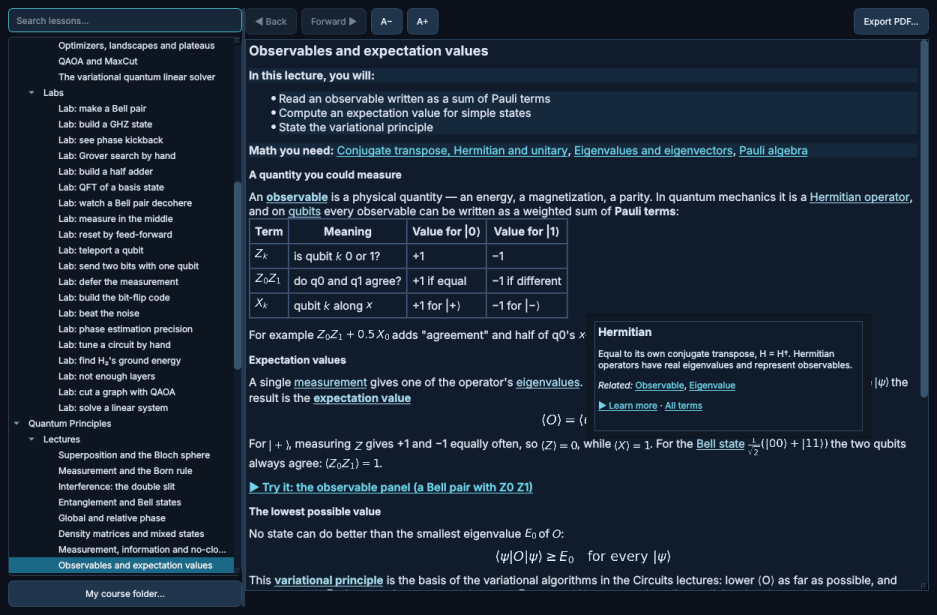

- **Contents:** lessons are grouped by area: **Quantum Circuits**, **Quantum Principles**, **Hydrogen**, **Mathematics** and **Quantum ML**. **Search lessons…** finds any lesson by its words.
- **Study guides:** each area starts with one. It says who the area is for and how long it takes, what to read first, the suggested order of lectures and labs, and what you should be able to do at the end. Each tab's **📖 Learn** button opens its area's study guide.
- **Lectures** explain a topic, always in the same order: **The idea** in a few sentences, the main content, a **Worked example** with numbers, **Common mistakes**, **In the app** (what to try, with Try it links), four questions and a **Summary**. **Math you need** at the top links to the Mathematics lessons it builds on.
- **Try it** links open the matching experiment or circuit in the main window.
- **Quizzes** check your understanding: click an answer to see whether it is right, and why.
- **Labs** give step-by-step tasks in every area — in the circuit simulator, the experiments, the Hydrogen views, Quantum ML or the calculator — and check each step as you complete it. A step ticks as soon as you have done it, and stays ticked when you move on.
- **The glossary:** underlined terms, such as *Hermitian*, show a short definition when clicked, with related terms and **Learn more**. **Glossary** in the contents lists all of them.
- **Reading:** **◀ Back** and **Forward ▶** move through the lessons you have visited, and **A−** and **A+** change the text size.
- **Export PDF…** saves the lesson as a handout, ending with the terms it uses.

**For teachers: My course.** **My course folder…** adds your own lessons and labs, written in the same simple format. They appear under **My course**, with glossary links and **Math you need** like the built-in ones. The file LEARN.md in the project describes the format.

## 9. Settings

**⚙** opens **Settings**. Changes apply at once, except where noted; **Restart now** restarts when needed, and **Restore defaults** resets everything (your recent files are kept).

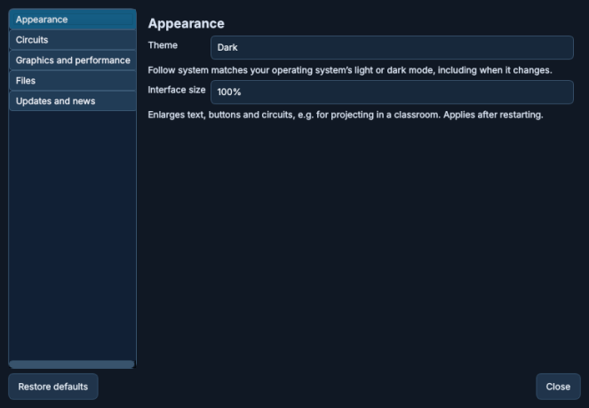

- **Appearance:** **Theme** (**Dark**, **Light** or **Follow system**) and **Interface size** (100–175%, useful for projecting in a classroom; applies after a restart).
- **Circuits:** defaults for new circuits:
  - **Qubits in a new circuit** and **Measurement shots**;
  - **Gate angles** in degrees or radians, and **Bit order in labels**, q0 leftmost (textbook) or rightmost (Qiskit);
  - **Amplitudes** shown exactly (1/√2) or as decimals, with **Decimal places**;
  - **Ask before clearing a circuit**.
- **Graphics and performance:** **Graphics device** (**Automatic**, **Integrated graphics**, or **NVIDIA (PRIME offloading)** on Linux laptops with two GPUs; applies after a restart). **Refresh** shows which graphics renderer is in use. **Watch memory and processor use** (on by default) shows a meter at the right of the status bar: QuantumScope's own memory, how full the computer's memory is, and how busy the processor is. It turns amber when memory is getting full and red when it is nearly full, and QuantumScope then says once what to do. Before a very fine 3-D grid or a large kernel that may not fit, it asks first.
- **Files:**
  - **Save and export to:** the default folder (**Browse…** or **Use Documents**);
  - **Autosave**;
  - **Probability report in PDF exports:** ask each time, always, or never;
  - **Recent circuits**, with **Clear recent list**.
- **Updates and news:** the current version and **Check for updates…**, and **QuantumScope news**: *Ask me*, *Read weekly* or *Never*.

## 10. Troubleshooting

**The 3-D view is blank, black or very slow.** Lower **Grid points/axis**, and update the graphics driver. On a laptop with two graphics chips, open **⚙ → Graphics and performance**, try the other **Graphics device**, then restart. **Refresh** shows which renderer is actually in use; include it if you report a problem.

**Everything is too small on a projector or a high-resolution screen.** Set **⚙ → Appearance → Interface size** to 125–175% and restart.

**Basis states are written in the opposite order to my textbook.** Change **⚙ → Circuits → Bit order in labels**. Only the labels change; the physics is identical.

**QuantumScope asks for a license, or refuses mine.** The message says why. *Not a QuantumScope license file* or *not valid*: choose the original .qslicense file your instructor sent, unchanged (do not open and save it in another program). *Ended on …*: the license's time is over; ask for a new one. On a new computer, or after reinstalling the system, add the same file again.

**QuantumScope closed unexpectedly.** When it starts again, it offers to recover your autosaved circuit.

**Check for updates says it cannot connect.** Check your internet connection and try again later. GitHub also limits how often it can be asked, so wait a while if you have checked many times. You can always download the latest release from the Releases page.

**Reporting a problem.** Press **⚑** (top right), or **Report a problem…** in **ⓘ**. Describe what happened and, if you like, what you expected. The dialog shows the whole report before anything leaves your computer: your description, the QuantumScope version, your system and the tab you were in, and nothing personal. **QuantumScope sends nothing itself:**
- **Send by email…** opens your email program with the report filled in, addressed to the QuantumScope team. It appears once a support address has been published in the news.
- **Open a GitHub issue…** opens a new issue in your browser. It needs a GitHub account, and issues are public.
- Either way the full report is copied to your clipboard, and, if you leave the box ticked, a screenshot of the window is saved to your Files folder for you to attach.

**If something goes wrong unexpectedly,** QuantumScope keeps running and offers **Report it…**, with the error's details already in the report. If anything looks wrong afterwards, save your work and restart.

**News.** The first time QuantumScope starts, a bar under the header asks whether it may read the QuantumScope news once a week: one public file on github.com, with nothing about you sent. If you allow it, announcements of new courses, workshops and features appear in that bar, one at a time; **✕** closes one for good. Change your choice in **⚙ → Updates and news**.

## 11. Mouse and keyboard reference

| Where | Action | Result |
|---|---|---|
| Circuit | drag from the palette | place a gate |
| Circuit | click a gate / double-click it | select it / edit its angles |
| Circuit | right-click a qubit's name | give the qubit a label |
| Circuit | right-click a gate | remove it |
| Circuit | click other qubits after dropping a multi-qubit gate | choose its other qubits |
| Palette | double-click a gate or noise item | explain it |
| Bloch sphere | left-drag | set the state (Entanglement: aim the detector) |
| Bloch sphere | right-drag, or Shift + left-drag | turn the sphere |
| Bloch sphere | double-click | reset the view |
| Double-Slit | drag the slits | change their separation |
| 3-D views | drag / scroll / Ctrl-drag | turn / zoom / move |
| Learn | click an underlined term | show its definition |
| Any tab | × on the tab | close it (it reopens as you left it) |

QuantumScope is by Md. Saif Hassan Onim, Southern Methodist University. It is not open source; its terms of use will be announced. Its simulations are idealized for teaching.
